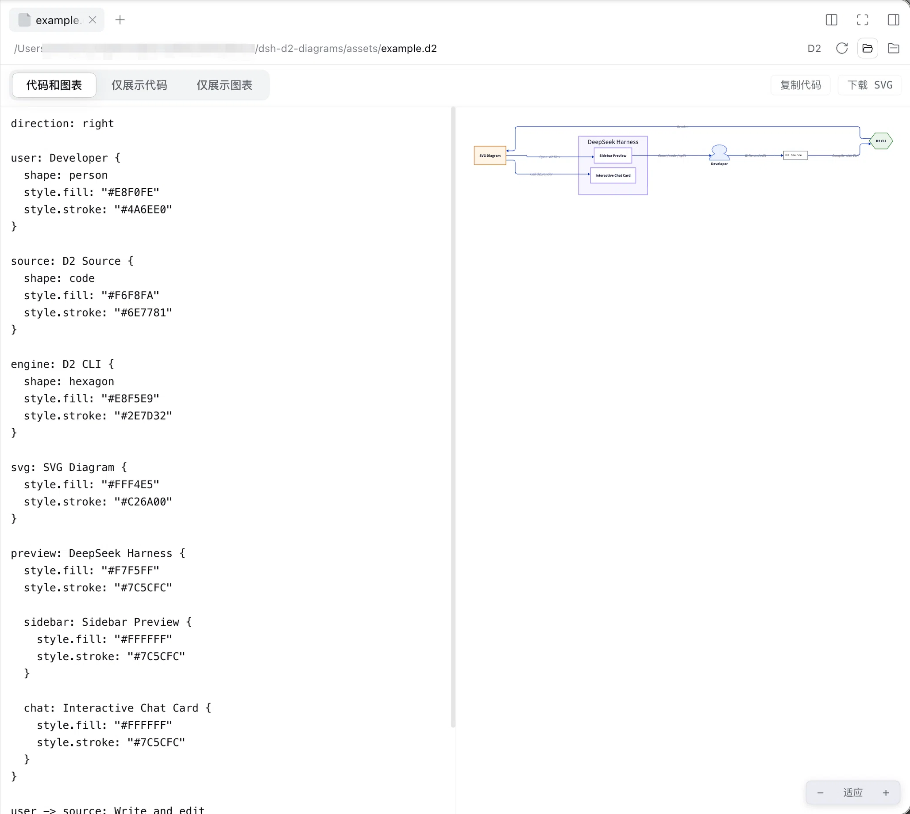
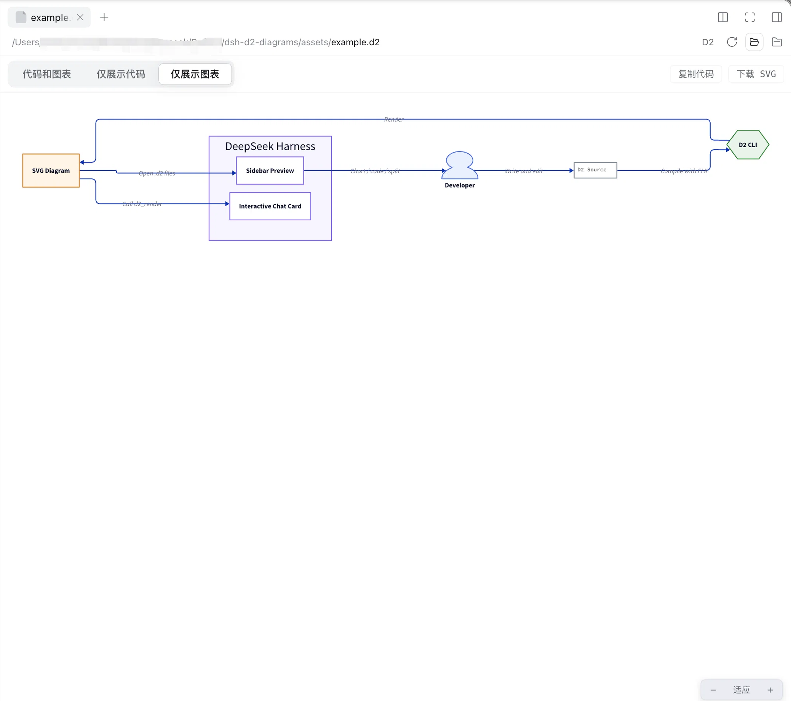

# dsh-d2-diagrams

[English](README.en.md) | [简体中文](README.md)

A [DeepSeek Harness](https://github.com/deepseek-ai/deepseek-harness) plugin for writing **D2** (d2lang) diagrams and rendering them live.

Open any `.d2` file in the right sidebar to get a Doc-like interactive diagram block:

- **Three view modes**: `Chart` / `Code` / `Code and chart` (two-column split).
- **Live rendering**: edit D2 source and the diagram automatically re-renders after a 450ms debounce. Syntax errors include line and column details, and the last successful result stays visible while rendering.
- **Zoom**: use the floating controls in the lower-right corner of the diagram (− / percentage / +; click the percentage to fit the width), or `Ctrl/⌘ + scroll` to zoom from 20% to 500%.
- **In-chat cards**: when the Agent calls the `d2_render` tool, the same interactive block appears directly in the conversation.
- **Theme support**: automatically follows the application's light or dark theme (D2 theme 0 / Dark Mauve 200).
- **Additional actions**: copy source code and download SVG.
- Preview edits are used only for live rendering and are not written back to the file. To save changes, edit the original file in the editor; the preview refreshes automatically when the file changes.

## About D2

[D2](https://github.com/d2lang/d2) is an open-source, declarative diagram scripting language. You describe nodes, relationships, containers, and styles in text, and D2 automatically lays out and generates the diagram. Because `.d2` source is plain text, it is easy to review, version, and collaborate on, making it suitable for architecture diagrams, flowcharts, sequence diagrams, ER diagrams, and more.

This plugin delegates compilation to the local D2 CLI rather than reimplementing the D2 rendering engine. Start with [`assets/example.d2`](assets/example.d2), and see the [official documentation](https://d2lang.com) and the [d2lang/d2 source repository](https://github.com/d2lang/d2) for the language syntax and additional capabilities.

## Screenshots

### Code and chart

Edit the D2 source on the left in split view, and the diagram on the right automatically re-renders after a 450ms debounce, making it easy to adjust nodes, connections, and layout interactively.



### Chart only

The chart view supports fitting the width, zooming, copying D2 source, and downloading SVG, while automatically following the application's light or dark theme.



## How it works

| Half | File | Responsibility |
|---|---|---|
| Host | `lib/index.js` | Registers the `/d2/render` route on the deployed webServer (behind the connection trust boundary) and invokes the local `d2` CLI to compile source into SVG, with safeguards for timeouts, output limits, and error presentation. |
| Client | `lib/client.js` | Registers a document renderer for the `.d2` extension through `ctx.documentPreviews.register` (loaded by `text-pages`) and mounts the body into the `sidebar.right.tab.document` keyed slot. |

The host must have [D2](https://d2lang.com) installed (for example, `brew install d2`). The default layout engine is `elk`; adjust it through the bundle patch `config` (see the comments in `cordis.patch.yml`).

## Installation

### Install from GitHub

```sh
dsh plugin --profile web add github:KorionCN/dsh-d2-diagrams
```

### Install from a local directory

Install the bundle by local path through the plugin manager:

```text
plugin_manager install_bundle  →  /absolute/path/to/dsh-d2-diagrams
```

## Development

```sh
pnpm install
pnpm run build   # Bundle src/client.jsx into lib/client.js with esbuild (ModuleLoader factory format)
```

After changing `src/client.jsx`, run `pnpm run build`, then restart the `d2-diagrams` entry from the Plugins page (or with `plugin_manager set_plugin`) to hot-reload it. The Host half (`lib/index.js`) is handwritten ESM and requires no build step.

Baseline modules (react, react-dom, react/jsx-runtime, @deepseek-ai/cordis, @deepseek-ai/dsh-client-store, @deepseek-ai/dsh-client-ui-dockkit, @deepseek-ai/dsh-client-ui-primitives, and @deepseek-ai/dsh-client-ui-slots) are provided by the Web shell's static module table and remain external during the build.
