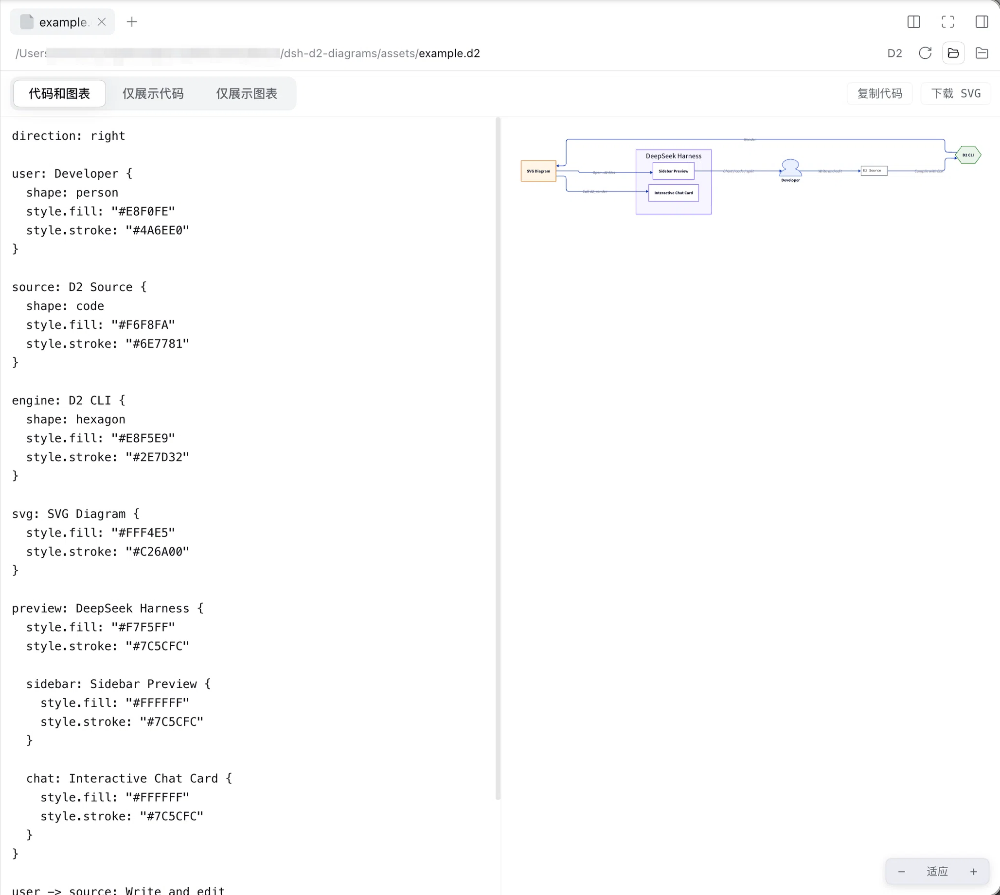
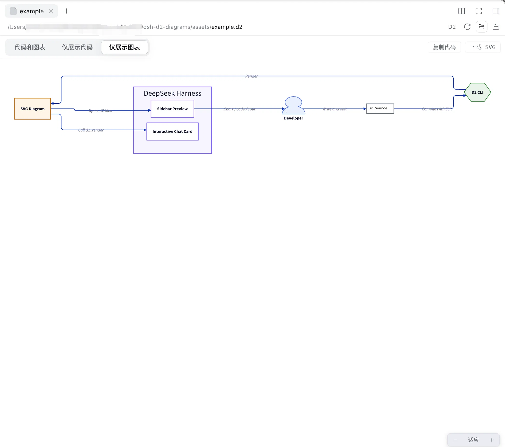

# dsh-d2-diagrams

[English](README.en.md) | [简体中文](README.md)

[DeepSeek Harness](https://github.com/deepseek-ai/deepseek-harness) 插件：用 **D2**（d2lang）绘图并实时渲染。

在右侧边栏打开任意 `.d2` 文件，即可获得 Doc 类产品同款的图表区块体验：

- **三种展示内容**：`仅展示图表` / `仅展示代码` / `代码和图表`（双列分屏）
- **实时修改渲染**：编辑 D2 源码，图表经 450ms 防抖后自动重新渲染；语法错误在图表区给出带行列号的提示，渲染中保留上一版成功结果
- **缩放**：图表区右下角悬浮控件（− / 百分比 / +，点百分比回到适应宽度），或 `Ctrl/⌘ + 滚轮` 缩放（20%–500%）
- **对话内卡片**：Agent 调用 `d2_render` 工具时，聊天流中直接内联同一个交互区块
- **主题跟随**：自动跟随应用的浅色 / 深色主题（D2 theme 0 / Dark Mauve 200）
- **附加操作**：复制代码、下载 SVG
- 编辑内容仅用于实时预览，不会写回文件；保存请使用编辑器修改原文件（预览会跟随文件变化自动刷新）

## 关于 D2

[D2](https://github.com/d2lang/d2) 是一种开源的声明式图表脚本语言：用文本描述节点、关系、容器与样式，由 D2 自动布局并生成图表。`.d2` 源码是纯文本，便于代码审查、版本管理与协作，适合架构图、流程图、时序图、ER 图等场景。

本插件调用本机 D2 CLI 完成编译，不重新实现 D2 渲染引擎。你可以从 [`assets/example.d2`](assets/example.d2) 开始体验；D2 语法和更多能力见 [官方文档](https://d2lang.com) 与 [d2lang/d2 源码仓库](https://github.com/d2lang/d2)。

## 使用截图

### 代码和图表

在分屏视图中编辑左侧 D2 源码，右侧图表会在 450ms 防抖后自动重新渲染，便于实时调整节点、连线和布局。



### 仅展示图表

图表视图支持适应宽度、缩放、复制 D2 源码和下载 SVG，并自动跟随应用的浅色或深色主题。



## 工作原理

| 半端 | 文件 | 职责 |
|---|---|---|
| Host | `lib/index.js` | 在部署的 webServer 上注册 `/d2/render` 路由（连接信任围栏之后），调用本机 `d2` CLI 把源码编译为 SVG；超时、输出上限、错误呈现均有防护 |
| Client | `lib/client.js` | 通过 `ctx.documentPreviews.register` 为 `.d2` 扩展名注册文档渲染器（`text-pages` 加载），body 挂入 `sidebar.right.tab.document` keyed 槽位 |

宿主需要安装 [d2](https://d2lang.com)（如 `brew install d2`）。布局引擎默认 `elk`，可在 bundle patch 的 `config` 中调整（见 `cordis.patch.yml` 注释）。

## 安装

### 从 GitHub 安装

```sh
dsh plugin --profile web add github:KorionCN/dsh-d2-diagrams
```

### 从本地目录安装

通过插件管理器按本地路径安装 bundle：

```text
plugin_manager install_bundle  →  /绝对路径/dsh-d2-diagrams
```

## 开发

```sh
pnpm install
pnpm run build   # esbuild 打包 src/client.jsx → lib/client.js（ModuleLoader 工厂格式）
```

修改 `src/client.jsx` 后重新 `pnpm run build`，再在 Plugins 页（或 `plugin_manager set_plugin`）重启 `d2-diagrams` 条目即可热更新。Host 半（`lib/index.js`）为手写 ESM，无需构建。

基线模块（react、react-dom、react/jsx-runtime、@deepseek-ai/cordis、@deepseek-ai/dsh-client-store、@deepseek-ai/dsh-client-ui-dockkit、@deepseek-ai/dsh-client-ui-primitives、@deepseek-ai/dsh-client-ui-slots）由 Web shell 的静态模块表提供，构建时保持 external。
